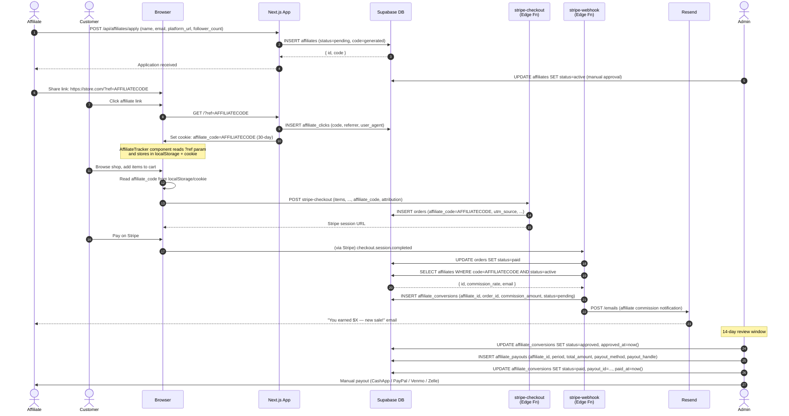

# Affiliate Program Flow



---

## Affiliate Data Model Relationships

```
affiliates
  │
  ├──► affiliate_clicks        (every link click, no auth required)
  │      code, referrer, user_agent, created_at
  │
  ├──► affiliate_conversions   (one per paid order)
  │      affiliate_id, order_id, order_subtotal, commission_amount
  │      status: pending → approved → paid | voided
  │      payout_id (FK → affiliate_payouts, set when paid)
  │
  └──► affiliate_payouts       (monthly batch)
         affiliate_id, period ("2025-01"), total_amount
         payout_method, payout_handle, stripe_memo
         status: pending → paid
```

---

## Attribution Cookie Lifecycle

```
Customer lands on /?ref=CODE
        │
        ▼
AffiliateTracker component (client-side)
        │
        ├── localStorage.setItem('affiliate_code', CODE)
        ├── document.cookie = 'affiliate_code=CODE; max-age=2592000' (30 days)
        └── INSERT affiliate_clicks (fire-and-forget)
                │
                ▼
        Customer adds to cart
                │
                ▼
        CartDrawer / checkout reads localStorage('affiliate_code')
                │
                ▼
        Passed as affiliate_code in stripe-checkout POST body
                │
                ▼
        Stored on orders.affiliate_code
                │
                ▼
        stripe-webhook reads orders.affiliate_code → creates conversion
```

---

## Commission Calculation

```
commission_amount = ROUND(order.subtotal × affiliate.commission_rate, 2)

Default commission_rate = 0.10 (10%)

Example:
  order.subtotal     = $89.97
  commission_rate    = 0.10
  commission_amount  = $8.997 → rounded to $9.00
```

---

## Conversion Status Flow

```
pending   ← INSERT by stripe-webhook on checkout.session.completed
    │
    │  Admin reviews (14-day window)
    ▼
approved  ← Admin UPDATE
    │
    │  Admin creates payout batch
    ▼
paid      ← Admin UPDATE (payout_id set, paid_at set)

OR

voided    ← Admin UPDATE (refund / fraud / dispute)
```
