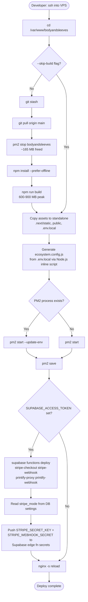

# Deployment Topology

## Infrastructure Overview

```
┌─────────────────────────────────────────────────────────────────────────────┐
│  DNS                                                                        │
│  bodyandsleeves.com  →  Droplet IP                                          │
│  www.bodyandsleeves.com  →  Droplet IP  (⚠️ no redirect — P1 SEO issue)     │
└──────────────────────────────────┬──────────────────────────────────────────┘
                                   │
                                   ▼
┌─────────────────────────────────────────────────────────────────────────────┐
│  DigitalOcean Droplet  (1 vCPU / 2 GB RAM / Ubuntu)                         │
│  /var/www/bodyandsleeves/                                                   │
│                                                                             │
│  ┌─────────────────────────────────────────────────────────────────────┐    │
│  │  nginx 1.18.0                                                       │    │
│  │  ─────────────────────────────────────────────────────────────────  │    │
│  │  :80  → 301 redirect → :443                                         │    │
│  │  :443 → proxy_pass http://127.0.0.1:3000                            │    │
│  │  TLS: Let's Encrypt cert                                            │    │
│  │  Security headers: X-Frame-Options, CSP, HSTS, etc.                 │    │
│  └──────────────────────────────┬──────────────────────────────────────┘    │
│                                 │                                           │
│                                 ▼                                           │
│  ┌─────────────────────────────────────────────────────────────────────┐    │
│  │  PM2 (process manager)                                              │    │
│  │  ─────────────────────────────────────────────────────────────────  │    │
│  │  app name:  bodyandsleeves                                          │    │
│  │  script:    .next/standalone/server.js                              │    │
│  │  max_memory_restart: 400M                                           │    │
│  │  node_args: --max-old-space-size=512                                │    │
│  │  env:       loaded from ecosystem.config.js (generated by deploy.sh)│    │
│  └──────────────────────────────┬──────────────────────────────────────┘    │
│                                 │                                           │
│                                 ▼                                           │
│  ┌─────────────────────────────────────────────────────────────────────┐    │
│  │  Next.js 15 Standalone  (port 3000)                                 │    │
│  │  ─────────────────────────────────────────────────────────────────  │    │
│  │  .next/standalone/server.js                                         │    │
│  │  .next/standalone/.next/static/   (copied by deploy.sh)             │    │
│  │  .next/standalone/public/         (copied by deploy.sh)             │    │
│  │  .next/standalone/.env.local      (copied by deploy.sh)             │    │
│  └─────────────────────────────────────────────────────────────────────┘    │
│                                                                             │
│  ┌─────────────────────────────────────────────────────────────────────┐    │
│  │  Git repo  /var/www/bodyandsleeves/                                 │    │
│  │  remote: github.com/lalohamb/singleuse-download-v1                  │    │
│  │  branch: main                                                       │    │
│  │  deploy key: /root/.ssh/github_deploy                               │    │
│  └─────────────────────────────────────────────────────────────────────┘    │
└─────────────────────────────────────────────────────────────────────────────┘

┌─────────────────────────────────────────────────────────────────────────────┐
│  Supabase Cloud                                                             │
│  ─────────────────────────────────────────────────────────────────────────  │
│  PostgreSQL DB  (14 tables, RLS enabled)                                    │
│  Auth           (JWT, magic link)                                           │
│  Storage        (image uploads)                                             │
│  Edge Functions (Deno runtime)                                              │
│    stripe-checkout  stripe-webhook  printify-proxy  printify-webhook        │
│  Secrets        (STRIPE_SECRET_KEY, PRINTIFY_API_TOKEN, RESEND_API_KEY ...) │
└─────────────────────────────────────────────────────────────────────────────┘
```

---

## Deploy Script Flow (`scripts/deploy.sh`)



---

## RAM Budget (1 vCPU / 2 GB Droplet)

| Phase | RAM Usage | Notes |
|---|---|---|
| Idle (app running) | ~165 MB | PM2 + Next.js standalone |
| During `npm run build` | 600–900 MB | TypeScript compile + webpack |
| Build + app running simultaneously | ~765–1065 MB | Risky on 2 GB — OOM possible |
| **deploy.sh strategy** | **stop app → build → restart** | ~30–60s downtime window |

---

## File Layout on VPS

```
/var/www/bodyandsleeves/
├── .next/
│   ├── standalone/          ← production server
│   │   ├── server.js        ← PM2 entry point
│   │   ├── .next/static/    ← copied by deploy.sh
│   │   ├── public/          ← copied by deploy.sh
│   │   └── .env.local       ← copied by deploy.sh
│   └── BUILD_ID
├── src/                     ← source (git tracked)
├── supabase/                ← migrations + edge functions (git tracked)
├── scripts/
│   └── deploy.sh
├── ecosystem.config.js      ← generated by deploy.sh (not committed)
├── .env.local               ← bootstrap secrets (gitignored)
└── package.json
```

---

## Zero-Downtime Alternative

`scripts/build-and-push.sh` builds locally and pushes the pre-built `.next/` to the server, avoiding the stop-build-restart cycle. Requires sufficient local RAM.

```
Local machine:
  npm run build
  rsync .next/ root@droplet:/var/www/bodyandsleeves/.next/
  ssh root@droplet "cd /var/www/bodyandsleeves && pm2 restart bodyandsleeves"
```
