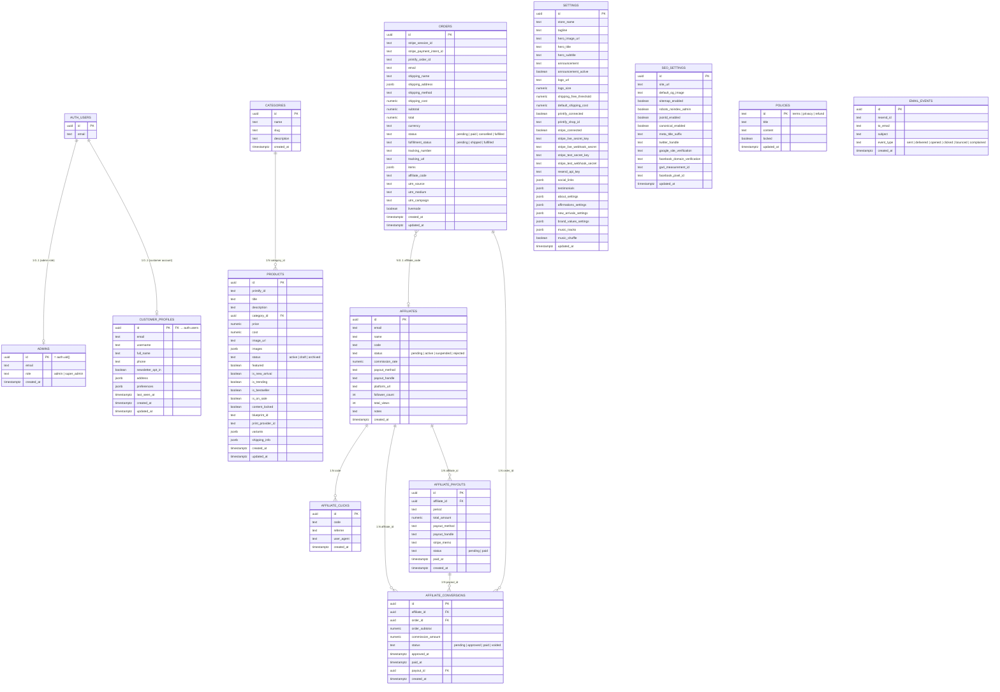

# Entity Relationship Diagram — POD Storefront



---

## Table Ownership & Access Summary

| Table | Public Read | Customer Read | Admin Write | Notes |
|---|:---:|:---:|:---:|---|
| `auth.users` | — | own row | — | Supabase managed |
| `admins` | ✗ | own row | super_admin only | |
| `customer_profiles` | ✗ | own row | ✓ (read) | |
| `categories` | ✓ | ✓ | ✓ | |
| `products` | ✓ | ✓ | ✓ | |
| `orders` | INSERT only | ✗ | ✓ | No public SELECT |
| `affiliates` | INSERT only | ✗ | ✓ | Signup is public |
| `affiliate_clicks` | INSERT only | ✗ | ✓ (read) | |
| `affiliate_conversions` | ✗ | ✗ | ✓ | |
| `affiliate_payouts` | ✗ | ✗ | ✓ | |
| `settings` | ✓ ⚠️ | ✓ ⚠️ | UPDATE only | GAP-012: secrets exposed via `select("*")` |
| `seo_settings` | ✓ | ✓ | ✓ | |
| `policies` | ✓ | ✓ | ✓ | |
| `email_events` | ✗ | ✗ | ✓ | |

> ⚠️ `settings` public read includes Stripe/Resend secret columns. Migration `20261017000000_restrict_settings_stripe_keys.sql` + `settings_public` view are the fix (pending deploy).

---

## External Service Connections

```
Next.js App (VPS)
  ├── Supabase DB          — all table reads/writes via supabase-js
  ├── Supabase Edge Fns    — stripe-checkout, stripe-webhook, printify-proxy, printify-webhook
  ├── Stripe               — payment sessions, webhooks
  ├── Printify             — product sync, order fulfillment, webhooks
  ├── Resend               — transactional email (order confirm, shipping)
  └── MailerLite           — newsletter subscriber list
```
