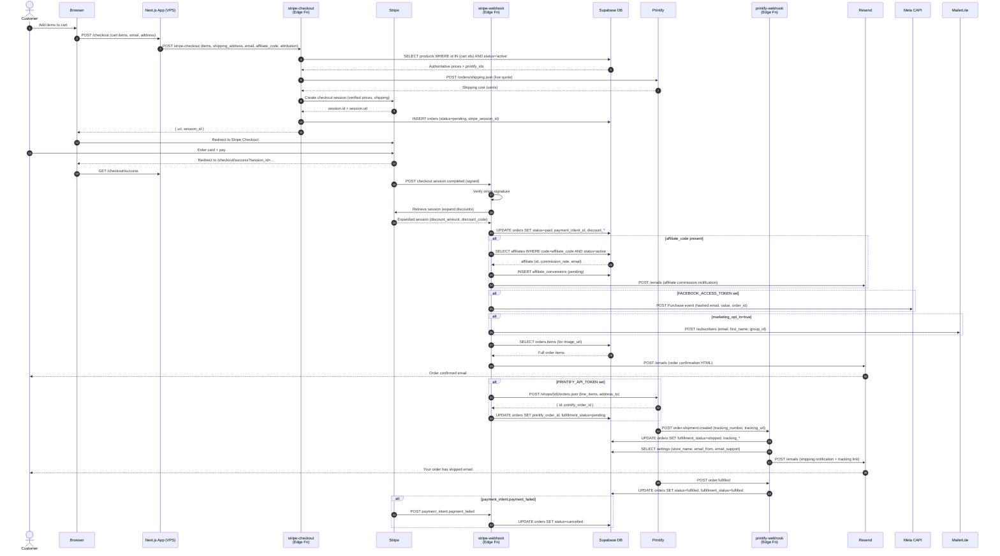

# Order Flow — Full Lifecycle Sequence



---

## Order Status State Machine

```
                    ┌─────────┐
                    │ pending │  ← INSERT by stripe-checkout
                    └────┬────┘
                         │ checkout.session.completed
                         ▼
                    ┌─────────┐
                    │  paid   │  ← UPDATE by stripe-webhook
                    └────┬────┘
                         │ POST to Printify
                         ▼
               ┌──────────────────┐
               │ fulfillment:     │
               │  in-production   │  ← order:created webhook
               └────────┬─────────┘
                        │ order:shipment:created
                        ▼
               ┌──────────────────┐
               │ fulfillment:     │
               │  shipped         │  ← tracking_number set
               └────────┬─────────┘
                        │ order:fulfilled
                        ▼
               ┌──────────────────┐
               │   fulfilled      │  ← terminal success state
               └──────────────────┘

  payment_intent.payment_failed → cancelled  (terminal failure state)
  order:cancelled               → cancelled  (terminal failure state)
```

---

## Key Data Passed Through Stripe Metadata

Stripe session metadata is the handoff between `stripe-checkout` and `stripe-webhook`. Fields are limited to 500 chars each.

| Field | Source | Used by |
|---|---|---|
| `email` | Customer input | Confirmation email, Printify address |
| `shipping_name` | Customer input | Printify address, email greeting |
| `shipping_address` | Customer input (JSON) | Printify address_to |
| `items` | Verified DB items (JSON) | Printify line_items, email HTML |
| `shipping_cost` | Live Printify quote | Order record |
| `subtotal` / `total` | Server-computed | Order record |
| `affiliate_code` | Cookie attribution | Conversion record |
| `marketing_opt_in` | Checkout checkbox | MailerLite subscribe |
| `phone` | Stripe phone collection | Printify address |
