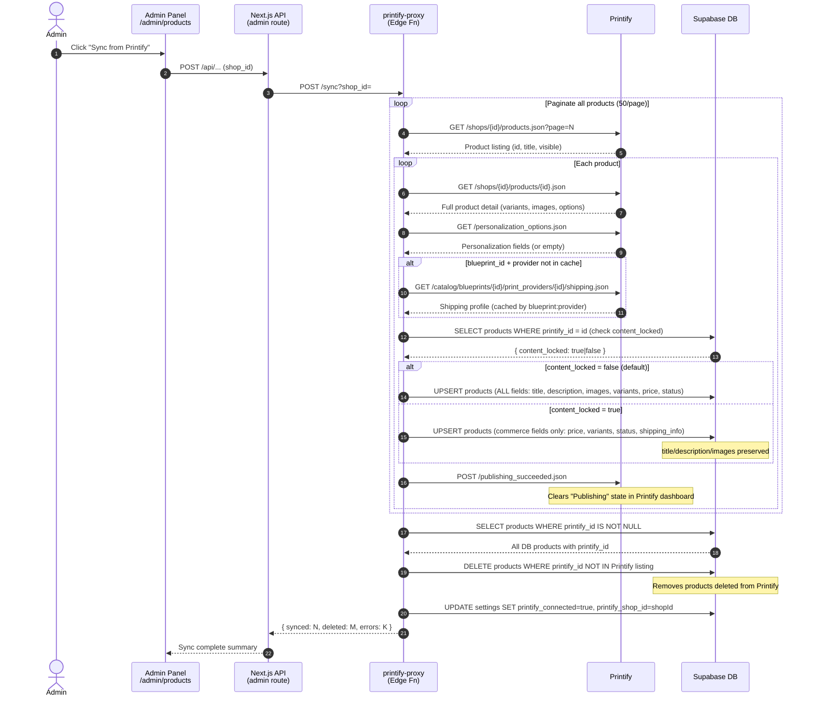
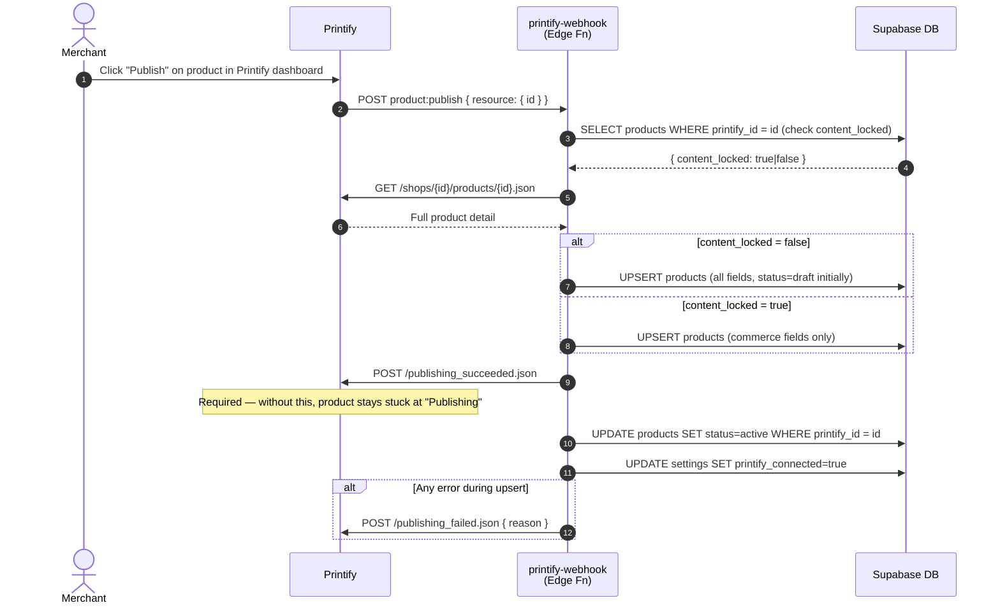

# Product Sync Flow

Two paths exist for getting Printify products into the local DB: admin-triggered bulk sync and Printify's publish webhook.

---

## Path A — Admin Bulk Sync



---

## Path B — Printify Publish Webhook



---

## content_locked Flag Behaviour

```
                    ┌─────────────────────────────────────────────────────┐
                    │  products row                                        │
                    │                                                      │
                    │  content_locked = false (default)                   │
                    │  ─────────────────────────────────────────────────  │
                    │  Sync overwrites:                                    │
                    │    title, description, image_url, images            │
                    │    price, cost, variants, status                    │
                    │    blueprint_id, print_provider_id                  │
                    │    shipping_info, is_personalizable                 │
                    └─────────────────────────────────────────────────────┘

                    ┌─────────────────────────────────────────────────────┐
                    │  products row                                        │
                    │                                                      │
                    │  content_locked = true  (admin toggle)              │
                    │  ─────────────────────────────────────────────────  │
                    │  Sync PRESERVES (admin-curated):                    │
                    │    title, description, image_url, images            │
                    │                                                      │
                    │  Sync still updates (commerce fields):              │
                    │    price, cost, variants, status                    │
                    │    blueprint_id, print_provider_id                  │
                    │    shipping_info, is_personalizable                 │
                    └─────────────────────────────────────────────────────┘
```

---

## Variant Resolution Logic

Printify stores variants as numeric option IDs. The sync resolves them to human labels:

```
Printify product.options[]
  └── { type: "color"|"size", values: [{ id: 123, title: "Black" }] }
          │
          ▼
  optionValues Map<id → { type, title }>
          │
          ▼
  variant.options[] (array of numeric IDs)
          │
          ├── type=color → color = "Black"
          └── type=size  → size  = "XL"
          │
          ▼
  colorImage Map<color → image_src>
  (only images specific to a single color — collage images excluded)
          │
          ▼
  Stored variant: { id, label, color, size, price, image_url }
```
