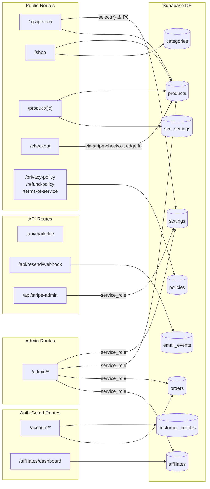

# Next.js Route Map

## Route Tree

```
src/app/
│
├── page.tsx                        [PUBLIC]  Home — RSC, queries settings + products
├── layout.tsx                      [ROOT]    Root layout — metadata, fonts, providers
├── robots.ts                       [PUBLIC]  /robots.txt — reads seo_settings.site_url
├── sitemap.ts                      [PUBLIC]  /sitemap.xml — reads seo_settings + products
│
├── shop/
│   └── page.tsx                    [PUBLIC]  Product listing — queries products + categories
│
├── product/
│   └── [id]/
│       └── page.tsx                [PUBLIC]  Product detail — JSON-LD, canonical (DB-gated)
│
├── checkout/
│   ├── page.tsx                    [PUBLIC]  Checkout form — calls stripe-checkout edge fn
│   ├── success/
│   │   └── page.tsx                [PUBLIC]  Post-payment success — reads session_id
│   └── cancel/
│       └── page.tsx                [PUBLIC]  Cancelled checkout
│
├── about/
│   └── page.tsx                    [PUBLIC]  About page — static metadata (⚠️ placeholder text)
│
├── privacy-policy/
│   └── page.tsx                    [PUBLIC]  Reads policies table (id='privacy')
│
├── refund-policy/
│   └── page.tsx                    [PUBLIC]  Reads policies table (id='refund')
│
├── terms-of-service/
│   └── page.tsx                    [PUBLIC]  Reads policies table (id='terms')
│
├── services/
│   └── page.tsx                    [PUBLIC]  Static services page
│
├── track/
│   └── page.tsx                    [PUBLIC]  Order tracking — reads orders by email
│
├── affiliates/
│   ├── page.tsx                    [PUBLIC]  Affiliate signup form
│   └── dashboard/
│       └── page.tsx                [AUTH]    Affiliate dashboard — requires auth
│
├── account/
│   ├── layout.tsx                  [AUTH]    Auth gate — redirects to login if no session
│   ├── page.tsx                    [AUTH]    Account overview
│   ├── orders/
│   │   └── page.tsx                [AUTH]    Customer order history
│   └── profile/
│       └── page.tsx                [AUTH]    Edit profile — reads/writes customer_profiles
│
├── admin/
│   ├── layout.tsx                  [ADMIN]   Admin auth gate — checks admins table
│   ├── page.tsx                    [ADMIN]   Admin login / redirect
│   ├── dashboard/
│   │   └── page.tsx                [ADMIN]   Stats: orders, revenue, products
│   ├── products/
│   │   └── page.tsx                [ADMIN]   Product list + Printify sync trigger
│   ├── orders/
│   │   └── page.tsx                [ADMIN]   Order management
│   ├── categories/
│   │   └── page.tsx                [ADMIN]   Category CRUD
│   ├── settings/
│   │   └── page.tsx                [ADMIN]   Brand/store settings (writes settings table)
│   ├── seo/
│   │   └── page.tsx                [ADMIN]   SEO settings (writes seo_settings table)
│   ├── shipping/
│   │   └── page.tsx                [ADMIN]   Shipping thresholds
│   ├── email/
│   │   └── page.tsx                [ADMIN]   Email template preview
│   ├── mailerlite/
│   │   └── page.tsx                [ADMIN]   MailerLite group ID config
│   ├── media/
│   │   └── page.tsx                [ADMIN]   Image upload to Supabase Storage
│   ├── policies/
│   │   └── page.tsx                [ADMIN]   Legal page editor (writes policies table)
│   ├── affiliates/
│   │   └── page.tsx                [ADMIN]   Affiliate management + payout tracking
│   └── stripe/
│       └── page.tsx                [ADMIN]   Stripe mode switch (test ↔ live)
│
└── api/
    ├── mailerlite/
    │   └── route.ts                [PUBLIC]  Newsletter subscribe endpoint
    ├── resend/
    │   └── webhook/
    │       └── route.ts            [SERVER]  Resend webhook → INSERT email_events
    ├── seo/
    │   └── route.ts                [PUBLIC]  SEO data endpoint
    ├── shipping-diagnostic/
    │   └── route.ts                [ADMIN]   Shipping debug endpoint
    └── stripe-admin/
        └── route.ts                [ADMIN]   Stripe mode switch API
```

---

## Route Classification

| Class | Auth Required | DB Access | Notes |
|---|---|---|---|
| `[PUBLIC]` | None | anon_key | Storefront pages, open to all |
| `[AUTH]` | Supabase session | authenticated | Customer account pages |
| `[ADMIN]` | admins table row | service_role | Admin panel — checked server-side |
| `[SERVER]` | Webhook signature | service_role | Server-to-server only |

---

## Data Access Per Route



---

## Security Boundaries

```
┌─────────────────────────────────────────────────────────────────┐
│  PUBLIC  (anon_key)                                             │
│  /, /shop, /product/*, /checkout, /about, /privacy-policy,     │
│  /refund-policy, /terms-of-service, /services, /track          │
│  /api/mailerlite, /api/seo                                      │
└─────────────────────────────────────────────────────────────────┘

┌─────────────────────────────────────────────────────────────────┐
│  AUTH-GATED  (Supabase session required)                        │
│  /account/*, /affiliates/dashboard                              │
│  Enforced by: account/layout.tsx redirect on no session         │
└─────────────────────────────────────────────────────────────────┘

┌─────────────────────────────────────────────────────────────────┐
│  ADMIN-ONLY  (admins table row required)                        │
│  /admin/*                                                       │
│  Enforced by: admin/layout.tsx → require-admin.ts              │
│               checks admins table via service_role              │
│  Cache-Control: no-store on all /admin/* responses              │
└─────────────────────────────────────────────────────────────────┘

┌─────────────────────────────────────────────────────────────────┐
│  SERVER-TO-SERVER  (webhook signature)                          │
│  /api/resend/webhook  — RESEND_WEBHOOK_SECRET HMAC              │
│  (Stripe/Printify webhooks go directly to Supabase edge fns)    │
└─────────────────────────────────────────────────────────────────┘
```
