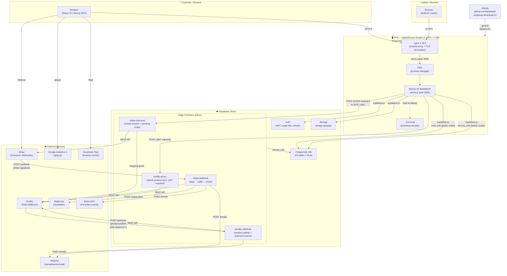

# System Architecture

---

## Connection Summary

| From | To | Protocol | Auth | Notes |
|---|---|---|---|---|
| Browser | nginx | HTTPS | — | TLS terminated at nginx |
| nginx | Next.js | HTTP | — | Internal proxy_pass :3000 |
| Next.js | Supabase DB | HTTPS (supabase-js) | anon_key | Public reads (storefront) |
| Next.js | Supabase DB | HTTPS (supabase-js) | service_role | Admin routes, bypasses RLS |
| Next.js | stripe-checkout | HTTPS | CORS (SITE_URL) | Cart → checkout |
| Next.js | printify-proxy | HTTPS | JWT (admin only) | Product sync |
| Stripe | stripe-webhook | HTTPS | stripe-signature | Payment events |
| Printify | printify-webhook | HTTPS | none | Product + order events |
| stripe-webhook | Printify | HTTPS | Bearer token | Order submission |
| stripe-webhook | Resend | HTTPS | Bearer API key | Order confirmation email |
| stripe-webhook | MailerLite | HTTPS | Bearer API key | Newsletter opt-in |
| stripe-webhook | Meta CAPI | HTTPS | Bearer access token | Purchase event |
| printify-webhook | Resend | HTTPS | Bearer API key | Shipping notification |
| Browser | Stripe.js | HTTPS | publishable key | Card collection |
| Browser | GA4 | HTTPS | measurement_id | Analytics |
| Browser | Facebook Pixel | HTTPS | pixel_id | Ad tracking |

---

## Secret Storage Locations

| Secret | Stored In | Used By |
|---|---|---|
| `SUPABASE_SERVICE_ROLE_KEY` | `.env.local` + PM2 env | Next.js admin routes |
| `NEXT_PUBLIC_SUPABASE_ANON_KEY` | `.env.local` + PM2 env | Next.js public reads |
| `STRIPE_SECRET_KEY` | Supabase edge fn secrets (synced from DB on deploy) | stripe-checkout, stripe-webhook |
| `STRIPE_WEBHOOK_SECRET` | Supabase edge fn secrets | stripe-webhook |
| `PRINTIFY_API_TOKEN` | Supabase edge fn secrets | printify-proxy, printify-webhook |
| `RESEND_API_KEY` | Supabase edge fn secrets + DB settings ⚠️ | stripe-webhook, printify-webhook |
| `MAILER_LITE_API_KEY` | Supabase edge fn secrets | stripe-webhook |
| `FACEBOOK_ACCESS_TOKEN` | Supabase edge fn secrets | stripe-webhook |
| `SUPABASE_ACCESS_TOKEN` | `.env.local` | deploy.sh (edge fn deploy) |

> ⚠️ `RESEND_API_KEY` is also stored in `settings.resend_api_key` (DB). Currently included in `settings_public` view — should be excluded in a follow-up migration.
